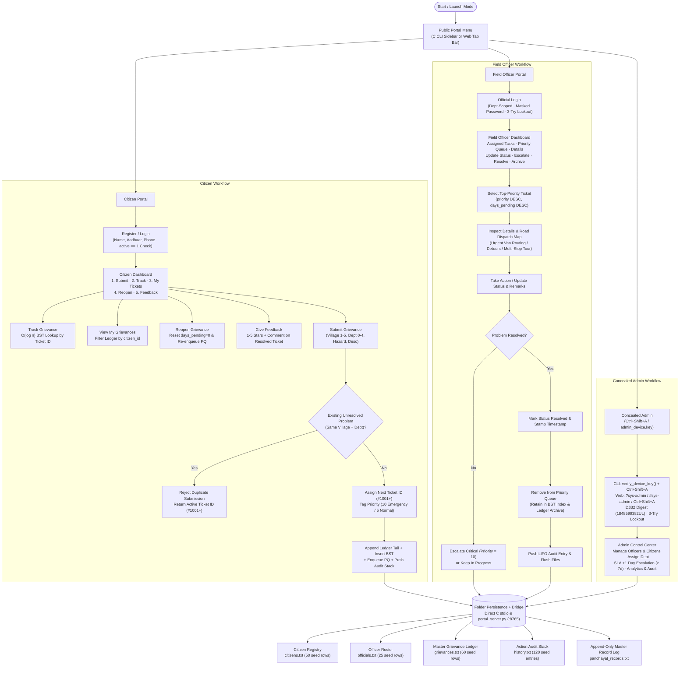

# 🌾 Rural Public Service Request & Grievance Management System

> **Dual-Mode Offline Civic Governance Platform** — Interactive C11 Console Application (`rural_grievance.c`) + Modular Gram Panchayat Web Portal (`index.html`, `styles.css`, `app.js`) + Local Folder Record Bridge (`portal_server.py`), built around foundational Data Structures, Field Road Dispatch Logistics, Hardware-Locked Concealed Admin Access, and Append-Only Plain-Text Persistence.

---

## 📋 Table of Contents

- [Overview](#-overview)
- [Key Features & Role Workflows](#-key-features--role-workflows)
- [System Architecture](#-system-architecture)
- [Engineering Design & Memory Invariants](#-engineering-design--memory-invariants)
- [Interactive Road Network & Field Dispatch Command Center](#-interactive-road-network--field-dispatch-command-center)
- [Security Hardening](#-security-hardening)
- [Plain-Text Storage Schema](#-plain-text-storage-schema)
- [Project Structure](#-project-structure)
- [Build & Quick Start](#-build--quick-start)
- [Verification & Testing](#-verification--testing)
- [Deliverables](#-deliverables)

---

## 🌟 Overview

Gram Panchayat offices and Common Service Centres (CSCs) frequently manage drinking-water, electricity, road, sanitation, and welfare complaints across surrounding villages under intermittent or zero cloud connectivity. Paper logbooks suffer from duplicate entries, missing accountability, unprioritized emergencies, and ad-hoc field dispatch routes.

This project solves that end-to-end with **zero external databases and zero third-party frameworks**:

- **Interactive C11 Console Engine ([rural_grievance.c](rural_grievance.c)):** Compiled memory-managed terminal application (`3,546` lines) combining singly linked ledgers, Binary Search Tree indexing, Priority Queue triage, LIFO audit stacks, cross-platform ANSI styling with a **slide-out left hover sidebar**, minimal boot/spinner animations, hardware-locked `Ctrl + Shift + A` Admin entry, and atomic plain-text persistence.
- **Modular Gram Panchayat Web Companion ([index.html](index.html), [styles.css](styles.css), [app.js](app.js)):** Separated HTML/CSS/ES6 dashboard featuring a warm rural aesthetic, live register filtering and search, priority dispatch queue triage, an **Interactive Road Logistics & Dispatch Command Center** (planar SVG map, urgent van routing, monsoon road closures, multi-village inspection tours, Dijkstra/BFS/DFS, and live `6×6` distance matrix), and full parity with the `.txt` database.
- **Live Folder Record Bridge ([portal_server.py](portal_server.py), [Start_Portal.bat](Start_Portal.bat)):** Standard-library Python local HTTP server (`127.0.0.1:8765`) synchronizing browser actions back into `citizens.txt`, `officials.txt`, `grievances.txt`, `history.txt`, and strictly appending immutable chronological log entries to `panchayat_records.txt`.
- **Service Scope & Preloaded Heavy Model Dataset:** Covers `1` Block HQ + `5` Rural Villages (`Rampur`, `Sitapur`, `Gopalpur`, `Krishnapur`, `Balipur`) across `5` Departments (`Water Supply`, `Electricity`, `Roads`, `Sanitation`, `Welfare Schemes`), pre-seeded with **`50` Citizens**, **`25` Field Officers**, **`60` Grievances**, **`120` History Audit entries**, and **`135` active Master Ledger log lines**.

---

## 👥 Key Features & Role Workflows

### 1. Interactive Terminal UI & Slide-Out Sidebar (`rural_grievance.c`)
- **Cross-Platform Virtual Terminal & Mouse Tracking:** `console_init()` enables UTF-8 output (`CP 65001`), ANSI box-drawing (`╭─╮│╰─╯`), and `ENABLE_VIRTUAL_TERMINAL_PROCESSING` / mouse tracking (`ENABLE_MOUSE_INPUT | ENABLE_EXTENDED_FLAGS` without Quick Edit lockups on Windows; SGR `\033[?1003h\033[?1006h` + raw `termios` on POSIX). Input tracking cleanly pauses (`console_leave_nav_mode()`) during `fgets` / `read_password()` form prompts and resumes automatically in menus.
- **Collapsible Left-Edge Drawer (`render_layout_with_sidebar`, `run_sidebar_menu`):** Defaults to a 3-column `▸MENU▸` edge strip along columns `1–3`. Moving the cursor to the left edge (`X <= 3`) or pressing `Tab` / `M` smoothly animates the drawer outward (`4 → 14 → 26` columns at `18ms`/frame), allowing click selection or number-key shortcuts (`1`, `2`, `0`), then slides closed when the cursor leaves (`X > 26`).
- **Fluid Startup & Verification Animations:** 20-block boot progress bar (`anim_boot_progress_bar()`), 10ms character-by-character typewriter portal banners (`anim_typewriter()`), and 3-frame Braille verification spinner (`anim_spinner()`) during authentication, device key verification, and `.txt` file saves.
- **Executable Directory Auto-Resolution:** `ensure_data_working_dir()` locates the folder containing `grievances.txt` next to `rural_app.exe` so launching from any shortcut keeps `.txt` databases synchronized.

### 2. Citizen Portal
- **Account Registration & Login:** Register with Full Name, Aadhaar Number (duplicate Aadhaar rejected), and Phone Number. Soft-deactivated citizens (`active == 0`) are automatically blocked from authentication.
- **Submit Grievance with Strict Duplicate Rejection:** Calls `ll_duplicate_check(village_id, dept_id, &existing_id)` before allocation. Any non-resolved ticket matching the same **Village + Department** rejects the duplicate submission and returns the existing active Ticket ID (`#1001+`).
- **Priority Scoring:** Life-safety hazards (`is_hazard = 1`) receive `PRIORITY_EMERGENCY = 10`; standard service requests receive `PRIORITY_NORMAL = 5`.
- **Tracking, Reopen & Feedback:** `O(log n)` BST ticket lookup (`bst_search`), personal ticket table filtered from `ledger_head`, one-step reopen for `"Resolved"` complaints (`days_pending = 0`, previous rating/feedback cleared, re-inserted into active Priority Queue), and 1–5 star post-resolution citizen ratings.

### 3. Field Officer Portal
- **Department-Scoped Triage Queue:** Reads `pq_front` ordered strictly by **`priority DESC, days_pending DESC`** so hazards and overdue cases surface first.
- **Ticket Triage & Status Escalation:** Inspects linked citizen contact details and remarks, updates workflow state (`Pending`, `In Progress`, or `Escalated` — automatically elevating `priority` to `10` and re-keying the priority queue), escalates overdue items, or marks complaints `"Resolved"` with closure timestamps while pruning finished items from `pq_front`.
- **Archive & Field Route Dispatch:** Reviews resolved history alongside citizen ratings and plans real-time inter-village dispatch itineraries in the Road Network tab.

### 4. Concealed Administrative Control Center
- **Personnel Roster Governance:** Add field officers, assign or reassign departments (`0–4` or `-1` for all departments), deactivate/reactivate accounts, or reset passwords.
- **Citizen Directory Governance:** Edit Name, Phone, and Aadhaar (with cross-account uniqueness checks), soft-deactivate or reactivate citizens while keeping historical ledger references intact, or purge records permanently.
- **SLA Aging Engine:** Simulates daily escalation cycles (`+1 Day`), promoting any unresolved ticket reaching `days_pending >= 7` (`ESCALATION_THRESHOLD`) to `PRIORITY_EMERGENCY (10)` with automatic priority-queue repositioning.
- **System Monitoring & Append-Only Audit Ledger:** Department backlog breakdowns, village pending loads, LIFO action history view, baseline dataset reset (`seed_initial_data`), and live persistence across all `.txt` files plus immutable `panchayat_records.txt` logging (replacing manual web backup downloads).

---

## 🏗 System Architecture

The overall architecture preserves three parallel vertical role workflows converging through shared in-memory data structures into human-readable persistent files:



### Data Structures Used

| Data Structure | C Implementation | Ownership / Invariant | Average Time Complexity |
| :--- | :--- | :--- | :--- |
| **Static Arrays** | `villages[6]`, `departments[5]`, `citizens[MAX_CITIZENS]` (`200`), `officials[MAX_OFFICIALS]` (`50`) | Fixed-capacity registries & geographic lookup tables | `O(1)` index lookup; `O(n)` credential scan |
| **Singly Linked List** | `GrievanceNode *ledger_head` | **Canonical owner** of all `GrievanceNode` records; tail-append & duplicate scan | `O(n)` append / `ll_duplicate_check()` |
| **Binary Search Tree** | `BSTNode *bst_root` | Non-owning `*ref` index keyed monotonically by `ticket_id` | `O(log n)` search (`bst_search`) & insert |
| **Priority Queue** | `PQNode *pq_front` | Active unresolved tickets ordered by `priority DESC, days_pending DESC` | `O(1)` top peek; `O(k)` sorted `pq_insert` / re-key |
| **LIFO Stack** | `HistEntry *hist_head` | Push-front compliance & action history log (newest displayed on top) | `O(1)` `hist_push` |
| **Weighted Graph** | `ROAD_GRAPH[6][6]` (`km`) & `getEffectiveGraph()` (Web) | Undirected adjacency matrix (`6` vertices, `10` corridors) supporting live closure toggles | `O(V²)` Dijkstra; `O(V + E)` BFS / DFS |
| **Plain-Text Streams** | `citizens.txt`, `officials.txt`, `grievances.txt`, `history.txt`, `panchayat_records.txt` | Human-readable `\|`-delimited storage + append-only event ledger via stdio & `portal_server.py` | `O(n)` load/save; `O(1)` master log append |

---

## ⚙️ Engineering Design & Memory Invariants

1. **Zero-Copy Reference Indexing (`*ref`):**
   - `BSTNode` and `PQNode` hold `GrievanceNode *ref` pointing directly into the canonical linked list (`ledger_head`), eliminating stale duplicate copies when remarks, statuses, or escalation flags change in place.
2. **Safe Priority Re-Keying (`pq_update_priority`):**
   - Whenever an official updates status to `Escalated` or the SLA engine promotes an overdue complaint (`days_pending >= 7`), `pq_remove(tid)` detaches the old queue wrapper before re-inserting at its updated `(priority, days_pending)` rank.
3. **Delimiter & Field-Boundary Protection:**
   - Every text input (`read_line`, `read_password`) calls `sanitize_pipes()` (replacing `|` with `-` and stripping `\r`/`\n`), while `portal_server.py` applies an identical `sanitize_pipes()` sanitizer so no entry can corrupt pipe-delimited `.txt` columns.
4. **Teardown Symmetry & Buffer Clearing:**
   - Exit and reset paths execute `ll_free_all()`, `bst_free(bst_root)`, `pq_free()`, and `hist_free()`, restore terminal/mouse modes (`console_restore_on_exit()`), and wipe credential buffers using `memset()`.

---

## 🗺 Interactive Road Network & Field Dispatch Command Center

Undirected rural block transport network (`6` nodes, `10` weighted road corridors in `km`; `—` denotes no direct road):

| Village | HQ | RAM | SIT | GOP | KRI | BAL |
| :--- | :---: | :---: | :---: | :---: | :---: | :---: |
| **Block HQ** | `·` | `5` | `8` | `—` | `12` | `—` |
| **Rampur** | `5` | `·` | `3` | `7` | `—` | `—` |
| **Sitapur** | `8` | `3` | `·` | `4` | `6` | `—` |
| **Gopalpur** | `—` | `7` | `4` | `·` | `2` | `9` |
| **Krishnapur** | `12` | `—` | `6` | `2` | `·` | `5` |
| **Balipur** | `—` | `—` | `—` | `9` | `5` | `·` |

### Real-World Web Dispatch Capabilities (`#panel-graph` in [index.html](index.html) & [app.js](app.js))
- **Planar Interactive SVG Map (`#road-svg-map`):** Zero-crossing layout displaying all 6 village nodes with live active/escalated ticket badges, urgent pulsing outlines, canal landmark overlay, and animated highlighted dispatch routes (`.edge-active`).
- **Dispatch Van to Active Grievance (`dispatchToTicket`):** Pulls open grievances directly into the route selector, chooses dispatch depot and vehicle speed profile (`28 km/h` Utility Van, `36 km/h` Emergency/Lineman Jeep, or `20 km/h` Heavy Repair Tractor), and calculates distance (`km`), ETA, diesel fuel estimate (`12 km/L`), and lead active officer.
- **Selected Location Field Dossier (`renderVillageDossier`):** Clicking any map node inspects distance/ETA from Block HQ, adjacent road links, active/escalated/resolved counts, and top pending complaints with one-click routing (`quickRouteToVillage`).
- **Monsoon / Damaged Road Closure Simulator (`toggleRoadClosure`, `getEffectiveGraph`):** Toggle any of the 10 corridors closed/open by clicking road labels on the SVG map, closure cards (`#road-closure-list`), or matrix cells (`#adj-matrix`). Dijkstra, BFS cutoff alerts (`#bfs-result`), DFS inspection sweeps, and KPI strips recalculate instantaneously around blocked roads.
- **Multi-Village Field Inspection Tour (`runMultiStopTour`):** Select multiple villages (or auto-select urgent wards via `selectUrgentTourVillages`) to chain shortest Dijkstra legs out from and back to Block HQ.

---

## 🔐 Security Hardening

1. **Hardware-Locked Secret Admin Trigger (C CLI):**
   - **Never Listed in Public UI:** Neither the collapsed sidebar nor the expanded navigation drawer shows `"Admin Portal"`. Public terminals display only `1. Citizen Portal`, `2. Official Portal`, and `0. Exit & Save`.
   - **Device Fingerprinting (`get_machine_fingerprint`):** Computes a 32-bit DJB2 digest of the OS machine identifier (`MachineGuid` via Windows Registry on Windows; `/etc/machine-id` or `/var/lib/dbus/machine-id` on POSIX). Running `./rural_app --bind-admin` once authenticates the administrator and stores the hex device key in `admin_device.key`.
   - **Secret `Ctrl + Shift + A` (`0x01`) Verification:** Pressing `Ctrl + Shift + A` on the Main Menu triggers `verify_device_key()`. If `admin_device.key` is absent or belongs to another PC, the CLI responds `[!] Invalid choice.` as if no Admin portal exists.
2. **Concealed Admin Entry (Web Portal):**
   - Public `.tab-bar` shows only `Overview`, `Citizen`, `Field Officer`, and `Road Network`. Authorized administrators open the portal via `Ctrl + Shift + A`, `?sys-admin`, or `#sys-admin` (`initHiddenAdminAccess()`).
3. **DJB2 One-Way Password Verification (`hash_password` / `hashPassword`):**
   - Zero plain-text admin passwords exist in source files, HTML, JS, or compiled binaries. Both `uint32_t` C hashing and `Math.imul(hash, 33) >>> 0` JavaScript hashing evaluate against `ADMIN_PASS_HASH = 1848599382UL`.
4. **Masked Passwords, Buffer Wiping & 3-Attempt Lockout:**
   - `read_password()` masks password keystrokes with `*` and handles Backspace safely. Consecutive invalid logins (`MAX_LOGIN_ATTEMPTS = 3`) lock out Official and Admin portals (`exit(1)` in C; locked login DOM in Web UI), and `memset()` clears sensitive credential arrays upon authentication/logout.

---

## 💾 Plain-Text Storage Schema

All persistent records reside locally inside the project folder using human-readable UTF-8 text files synchronized between C CLI file I/O and `portal_server.py`:

| File | Format / Header & Columns |
| :--- | :--- |
| **`citizens.txt`** | `# NEXT_CITIZEN_ID` • `citizen_id\|aadhaar\|phone\|active\|name` (`50` baseline rows) |
| **`officials.txt`** | `# NEXT_OFFICIAL_ID` • `official_id\|username\|password\|dept_assigned\|active\|name` (`25` baseline rows) |
| **`grievances.txt`** | `# NEXT_TICKET_ID` • `ticket_id\|citizen_id\|village_id\|dept_id\|is_hazard\|priority\|days_pending\|assigned_official_id\|status\|submitted_at\|resolved_at\|rating\|description\|remarks\|feedback` (`60` baseline rows) |
| **`history.txt`** | `# ACTION / AUDIT HISTORY LOG` • `ticket_id\|action\|actor\|timestamp` (`120` baseline entries) |
| **`panchayat_records.txt`** | **Append-Only Master Record Ledger** (`TIMESTAMP \| SOURCE \| RECORD_TYPE \| #ID \| ACTOR \| DETAILS`; strictly appends every citizen, official, grievance, escalation, resolve, and SLA event; `135` baseline entries) |
| **`admin_device.key`** | Optional hex hardware fingerprint written once by `./rural_app --bind-admin` (ignored/excluded from public distribution) |

---

## 📁 Project Structure

```text
rural_grievance_system/
├── rural_grievance.c                   # C11 CLI engine + slide-out sidebar + security (3,546 lines)
├── rural_app.exe                       # Compiled Windows executable
├── index.html                          # Modular Web Portal UI markup (752 lines)
├── styles.css                          # Warm Gram Panchayat stylesheet & animations (588 lines)
├── app.js                              # Portal logic, datasets, folder sync & road logistics (2,298 lines)
├── portal_server.py                    # Local HTTP bridge (127.0.0.1:8765) + append ledger (390 lines)
├── Start_Portal.bat                    # One-click Windows launcher for server + browser UI (17 lines)
├── citizens.txt                        # Citizen directory registry (50 seeded citizens)
├── officials.txt                       # Field officer accounts (25 seeded officials)
├── grievances.txt                      # Master grievance ledger (60 seeded tickets)
├── history.txt                         # Chronological action stack file (120 seeded events)
├── panchayat_records.txt               # Append-only master transaction ledger (135 baseline events)
├── Rural_Grievance_Capstone_Report.docx # Formal Word Capstone Project Report
└── README.md                           # Project documentation
```

---

## 🚀 Build & Quick Start

### Option A — Native C11 Console Application

1. **Compile cleanly with GCC:**
   ```bash
   gcc rural_grievance.c -o rural_app -Wall -Wextra -std=c11
   ```
2. **Launch Public Service Portal (Mouse Hover Sidebar + Keyboard):**
   ```powershell
   .\rural_app.exe
   ```
   *(Move cursor to the far-left edge or press `Tab` / `M` to expand the navigation drawer.)*
3. **One-Time Hardware Admin Binding & Secret Access:**
   ```powershell
   .\rural_app.exe --bind-admin
   ```
   After binding, press **`Ctrl + Shift + A`** on the Main Menu to open the Admin Portal on the bound machine.

### Option B — Live Folder-Synced Web Portal *(Recommended)*

Double-click **`Start_Portal.bat`** (or start `python portal_server.py` and open `http://127.0.0.1:8765/index.html`):
- Reads live `.txt` files on startup (`GET /api/state`), persists mutations immediately back to `citizens.txt`, `officials.txt`, `grievances.txt`, `history.txt`, and appends every chronological action to `panchayat_records.txt` (`POST /api/append`).
- Press **`Ctrl + Shift + A`** (or append `?sys-admin` / `#sys-admin`) to reveal the Admin Control Center.

### Option C — Zero-Server Offline Browser Mode

Open **`index.html`** directly over `file:///` in Chrome, Edge, or Firefox. The portal automatically runs against its built-in 50-citizen / 25-officer / 60-grievance dataset in browser `localStorage`.

---

## ✅ Verification & Testing

- **C11 Compilation Audit:** `gcc rural_grievance.c -fsyntax-only -Wall -Wextra -std=c11` passes with **0 warnings, 0 errors** across all `3,546` source lines.
- **Security, Lockout & Sanitization Checks:** Verified `0` plain-text admin secret occurrences in `rural_grievance.c`, `rural_app.exe`, `index.html`, `styles.css`, `app.js`, and `portal_server.py`; confirmed unbound `Ctrl + Shift + A` (`0x01`) yields `[!] Invalid choice.`, `3` invalid officer logins trigger exit code `1`, and `|` pipe inputs sanitize cleanly to `-` before persisting to `citizens.txt` and `panchayat_records.txt`.
- **Expanded Dataset & Invariants:** Confirmed `50` citizens (unique Aadhaar IDs), `25` officers, `60` grievances (zero duplicate unresolved `Village + Dept` pairs; every `Escalated` ticket carries `priority == 10`), `120` history entries, and `135` active `panchayat_records.txt` ledger lines synced identically between `rural_app.exe` and `portal_server.py`.
- **Web DOM, SVG Map & Distance Matrix Chrome Check:** Verified in headless Chrome across `index.html`, `styles.css`, and `app.js` with `126` matched DOM IDs, `10` clickable SVG road corridors, `6` village nodes (`0` bounding-box overlaps), `dispatchToTicket()` initial urgent route highlighting (`#1008`), and aligned `7`-column `.g-table` matrix headers (`Village`, `HQ`, `RAM`, `SIT`, `GOP`, `KRI`, `BAL`).

---

## 📦 Deliverables

- **C11 CLI Source & Binary:** [rural_grievance.c](rural_grievance.c) · [rural_app.exe](rural_app.exe)
- **Modular Web Portal & Local Sync Server:** [index.html](index.html) · [styles.css](styles.css) · [app.js](app.js) · [portal_server.py](portal_server.py) · [Start_Portal.bat](Start_Portal.bat)
- **Capstone Project Report:** [Rural_Grievance_Capstone_Report.docx](Rural_Grievance_Capstone_Report.docx) (14-Page Formal Word Report)
